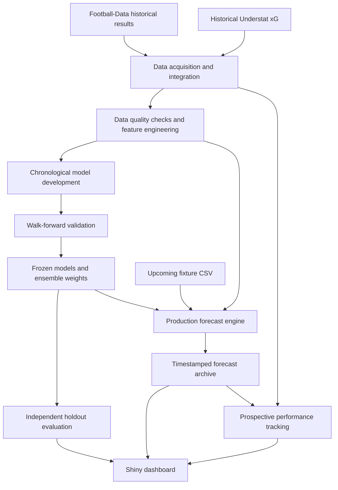

f# Super 6 Predictor

**Football forecasting, statistical modelling and interactive data storytelling in R.**

Super 6 Predictor is an end-to-end football forecasting project inspired by Sky Sports Super 6. It estimates the probability of individual Premier League scorelines, ranks the most likely results and presents forecasts through an interactive R Shiny dashboard.

The project began with a simple question: **can we improve on a basic football prediction model by incorporating team strength, recent performances and expected goals?** Rather than assuming that more complex models are better, I developed and compared a series of statistical approaches using chronological validation, independent holdout testing and uncertainty analysis.

The current scope is Premier League fixtures involving Arsenal, Chelsea, Liverpool, Manchester City, Manchester United or Tottenham Hotspur. The project is independent of Sky and is not an official Super 6 product.

## Key findings

| Metric | Result |
| --- | ---: |
| Walk-forward validation fixtures | 594 |
| Independent holdout fixtures | 396 |
| Best historical-data ensemble log loss (M10B) | 2.943232 |
| Reduction in holdout log loss vs baseline (M2) | 2.47% |
| Best holdout exact scoreline accuracy (M7A) | 12.88% |
| Top-five scoreline accuracy (M10B) | 47.47% |

The xG-enhanced ensemble improved probabilistic forecasting relative to the fixture-based Poisson baseline on unseen data. However, the improvement in exact scoreline accuracy was statistically inconclusive. The strongest model for probability estimation was not necessarily the strongest model for selecting one exact scoreline.

## Interactive dashboard

The Shiny application turns the model outputs into an interactive football intelligence product. It has six pages:

| Page | Features |
| --- | --- |
| Matchweek | Fixture forecasts, expected scoring rates, outcome probabilities and ranked scorelines |
| Match explorer | Scoreline probability heatmaps and comparisons between component models |
| Team intelligence | Historical Elo ratings and rolling goals and expected goals trends |
| Model laboratory | Validation and holdout leaderboards, ensemble weights, calibration and bootstrap uncertainty intervals |
| Live performance | Archived forecasts versus actual results, prospective accuracy and log loss, with CSV export |
| Methodology | Data sources, model specifications, evaluation design and limitations |

<!-- Optional: add real dashboard screenshots to screenshots/ and insert Markdown image links here. Suggested views: Matchweek, Match explorer and Model laboratory. -->

## Data sources

| Source | Use |
| --- | --- |
| [Football-Data.co.uk](https://www.football-data.co.uk/) | Historical Premier League results, match statistics and bookmaker odds |
| [Understat](https://understat.com/) data via [xGTables](https://www.xgtables.io/) | Historical expected goals (xG) for feature engineering |
| Manually maintained fixture input | Upcoming fixtures for prospective forecasting |

Historical results from 2016/17 onwards are used to estimate team strengths. Models are trained on all available Premier League matches, while the reported evaluation focuses on fixtures involving the traditional Big Six.

The data pipeline standardises team identifiers, checks for missing values and duplicates, and integrates results with historical xG records. xG from different providers is kept separate because the underlying estimation methodologies may differ.

## Project architecture



## Statistical methodology

### Model development

A series of increasingly informative models was evaluated to determine which features and techniques improved forecast quality.

| Model | Approach |
| --- | --- |
| M0 / M1 | Historical scoreline frequencies, overall and by fixture type |
| M2 | Independent Poisson using historical scoring rates by fixture type |
| M3 / M3W | Poisson regression with home advantage, team attack and opponent defence effects; weighted variant uses a 180-day half-life |
| M4 / M5 | Two-stage Dixon–Coles low-score adjustment, including time-weighted variants |
| M6A / M6B | Rolling actual goals, with and without team effects |
| M7A / M7B | Rolling expected goals, with and without team effects |
| M8 | Market-implied Poisson scoring rates reconstructed from bookmaker odds |
| M9A / M9B | Elo-based Poisson regression, with and without team effects |
| M10A / M10B / M10C | Weighted combinations of complete scoreline probability distributions |

### Poisson regression

Goals are modelled as count variables. For a fixture with expected home and away scoring rates, the independent Poisson model estimates the joint probability of every possible scoreline:

```math
P(H=h,A=a) = \frac{e^{-\lambda_H}\lambda_H^h}{h!}\frac{e^{-\lambda_A}\lambda_A^a}{a!}
```

The team-strength model uses a log link to estimate scoring rates from home advantage, attacking strength and opposition defensive effects. Exponential time weighting gives recent matches more influence; six candidate half-lives were tested during validation.

Rolling form and xG features use up to ten prior matches within a 365-day window, with shrinkage towards the league average. The weekly forecast cutoff ensures that only previous match results contribute to a fixture's features.

### Probability ensembles

Ensembles combine entire scoreline distributions, rather than averaging predicted scorelines or scoring rates. Component weights are non-negative, sum to one and were selected by minimising validation log loss over a grid in 10-percentage-point increments.

| Component | M10A — production | M10B — research | M10C — market |
| --- | ---: | ---: | ---: |
| M2: fixture-based Poisson | 20% | 10% | 0% |
| M3W: weighted team-strength Poisson | 80% | 30% | 10% |
| M7A: rolling xG | 0% | 20% | 0% |
| M7B: hybrid xG | 0% | 40% | 0% |
| M8: market Poisson | 0% | 0% | 90% |

The hybrid Elo model was also considered for every ensemble but received zero weight in the selected configurations.

## Experimental design

A chronological split was used to reflect how a forecasting model would operate in practice.

| Period | Purpose | Fixtures |
| --- | --- | --- |
| 2016/17–2020/21 | Initial training and feature history | 1,900 league matches |
| 2021/22–2023/24 | Walk-forward validation and model selection | 594 Big Six fixtures |
| 2024/25–2025/26 | Independent holdout evaluation | 396 Big Six fixtures |
| 2026/27 onwards | Prospective forecasts | Timestamped forecast archive |

For each prediction week, the models are fitted using matches played before the Monday cutoff. Model specifications, feature parameters and ensemble weights are frozen before holdout evaluation; model coefficients may be updated as new historical results become available.

Forecast performance is assessed using exact scoreline accuracy, top-three and top-five accuracy, match outcome accuracy, log loss and calibration. Paired block bootstrap simulations estimate uncertainty in model performance differences while approximately accounting for dependence between matches in nearby weeks.

## Results

### Validation performance

| Model | Exact accuracy | Log loss |
| --- | ---: | ---: |
| M2 — fixture Poisson | **12.29%** | 3.09 |
| M3W — weighted Poisson | 10.10% | 3.017622 |
| M7A — xG form | 10.44% | 3.061468 |
| M7B — hybrid xG | 9.60% | 3.015012 |
| M10A — core ensemble | 9.60% | 3.011446 |
| M10B — xG ensemble | 9.09% | **3.003698** |

The simple fixture-based baseline achieved the highest exact scoreline accuracy during validation, despite its weaker log loss. This motivated an independent assessment of whether its advantage would persist.

### Independent holdout performance

All models below were evaluated on the same 396 Big Six fixtures across 2024/25 and 2025/26.

| Model | Correct scores | Exact accuracy | Top 3 | Top 5 | Log loss ↓ |
| --- | ---: | ---: | ---: | ---: | ---: |
| **M10B — xG ensemble** | 47 | 11.87% | **32.3%** | **47.5%** | **2.943232** |
| M10A — core ensemble | 42 | 10.61% | 31.6% | 46.5% | 2.952913 |
| M7A — xG form | 51 | **12.88%** | 32.1% | 46.7% | 2.959738 |
| M3W — weighted Poisson | 45 | 11.36% | 28.8% | **47.5%** | 2.987694 |
| M7B — hybrid xG | 48 | 12.12% | 29.8% | 47.0% | 2.987818 |
| M2 — fixture Poisson | 43 | 10.86% | 29.3% | 43.4% | 3.017619 |

M10B achieved the lowest log loss among the historical-data models. M7A achieved the highest exact scoreline accuracy, but its accuracy varied from 18.18% in 2024/25 to 7.58% in 2025/26. M10B was more consistent across these two seasons.

### Uncertainty analysis

5,000 paired block bootstrap simulations were used for each comparison. Positive improvements favour the candidate model.

| Candidate vs benchmark | Log loss improvement | Approx. 95% interval | Exact accuracy improvement | Approx. 95% interval (pp) |
| --- | ---: | --- | ---: | --- |
| M10B vs M2 | +0.0744 | [0.0260, 0.1250] | +1.01 pp | [-2.01, 4.10] |
| M10B vs M10A | +0.00968 | [0.000606, 0.0177] | +1.26 pp | [-0.506, 3.11] |
| M7A vs M10B | -0.0165 | [-0.0456, 0.00984] | +1.01 pp | [-1.90, 3.76] |

The results support improved probabilistic forecasting relative to M2, but all exact-accuracy intervals include zero. These are exploratory, unadjusted intervals from comparisons selected after inspecting holdout results; they should not be interpreted as definitive confirmatory tests.

### Market benchmark

| Model | Exact accuracy | Top 5 | Log loss ↓ |
| --- | ---: | ---: | ---: |
| M8 — market Poisson | 10.61% | 50.0% | **2.899906** |
| M10C — market ensemble | 10.10% | 49.2% | 2.903148 |

The standalone market model achieved better holdout log loss than the market-enhanced ensemble. Historical odds may have been recorded after the Monday prediction cutoff, so these results are reported separately rather than treated as a fair same-time comparison.

### Lessons from model development

- Greater model complexity did not automatically improve exact scoreline accuracy.
- The tested two-stage Dixon–Coles adjustment provided little additional value.
- Elo ratings did not contribute positive weight to the selected ensembles.
- Expected goals showed greater value when combined with other models than when used in the hybrid model alone during validation.
- Adding the historical model to market probabilities did not improve holdout log loss.

## Production forecasting

**M10A** is the current production model: 20% fixture-based Poisson and 80% time-weighted team-strength Poisson. **M10B** remains the preferred historical research model, but is not deployed because current-season xG from Football-Data has not been reconciled with historical Understat data.

The production system generates:

- The most probable exact scoreline and its estimated probability.
- The six highest-ranked alternative scorelines (including the first-choice score).
- Expected home and away goals, and home/draw/away probabilities.
- A full numerical scoreline probability grid with negligible omitted tail mass.
- Timestamped forecast files for prospective evaluation.

The dashboard tracks the earliest eligible archived forecast per fixture and model. Until verified kickoff timestamps are incorporated, eligibility conservatively requires forecasts to have been generated before midnight UK time at the start of match day. Reference/demo forecasts are excluded from prospective evaluation.

## Getting started

### Requirements

R and RStudio are recommended. Install the packages required by the modelling pipeline and Shiny dashboard:

```r
install.packages(c(
  "tidyverse", "lubridate", "here", "janitor"
  "shiny", "bslib", "plotly", "DT", "jsonlite"
))
```

### Launch the dashboard

From the project root in RStudio:

```r
shiny::runApp("dashboard")
```

The app reads existing pipeline outputs. If local data are missing, it can display the included reference forecast and model-performance snapshots, provided the `dashboard/reference/` directory is present. Reference mode is not a live feed and does not fabricate missing probability distributions, team histories or results.

For dashboard-specific setup instructions, see [dashboard/README.md](dashboard/README.md). The optional dashboard smoke test can be run with:

```r
source("dashboard/smoke_test.R")
```

### Generate new forecasts

1. Refresh the historical data using the existing acquisition and integration pipeline (the `run_data_pipeline.R` script).
2. Update `data/raw/fixtures_to_predict.csv` with the verified upcoming Big Six fixtures, using the same team names as the master dataset. The required format is:

   ```csv
   date,home_team,away_team
   2026-11-27,Nott'm Forest,Chelsea
   ```

   This is a historical example of the input format, not a current fixture recommendation.
3. From the project root, run the production forecasting script before the matches take place:

   ```r
   source(here::here("R", "17_production_forecasts.R"))
   ```
4. Open the dashboard or select **Refresh data** to load the new forecast archive.
5. After the matches, refresh the historical results and dashboard to evaluate the archived predictions. The optional `R/18_forecast_tracking.R` script also exports a tracking summary.

The dashboard is read-only with respect to the model pipeline. It does not retrain models or overwrite archived forecasts.

## Repository structure

The following is the intended project layout. Data files and output folders are generated by the pipeline and may not all be committed to the repository.

```text
Super-6-Predictor/
├── README.md
├── R/                          # Acquisition, modelling and evaluation scripts
│   ├── 01_data_acquisition.R
│   ├── 02_xg_acquisition.R
│   ├── 03_data_integration.R
│   ├── 04_exploratory_analysis.R
│   ├── 05_baseline_models.R
│   ├── 06_poisson_regression.R
│   ├── 07_dixon_coles.R
│   ├── 08_feature_engineering.R
│   ├── 09_dynamic_poisson.R
│   ├── 10_xg_feature_engineering.R
│   ├── 11_xg_poisson.R
│   ├── 12_market_poisson.R
│   ├── 13_elo_ratings.R
│   ├── 14_ensemble_models.R
│   ├── 15_holdout_evaluation.R
│   ├── 16_holdout_uncertainty.R
│   ├── 17_production_forecasts.R
│   └── 18_forecast_tracking.R
├── data/
│   ├── raw/                    # Source files and fixture input
│   └── processed/              # Integrated data and team features
├── outputs/
│   ├── validation/             # Walk-forward model results
│   ├── holdout/                # Independent evaluation
│   ├── forecasts/              # Timestamped forecasts
│   └── tracking/               # Prospective performance exports
└── dashboard/
    ├── app.R                   # Interactive Shiny application
    ├── README.md
    ├── smoke_test.R
    └── reference/              # Reported results and example forecasts
```

## Limitations and future development

- **Competition scope:** evaluation covers individual Big Six fixtures, not actual six-match Super 6 rounds. No improvement in competition scores or jackpot probability has been established.
- **Forecast uncertainty:** exact scorelines are inherently difficult to predict; high-ranked alternatives should not be interpreted as guaranteed outcomes.
- **Data coverage:** injuries, lineups, tactical matchups and cross-division strength estimates for promoted teams are not explicitly incorporated.
- **Data timing:** match-specific odds collection timestamps and current-season xG consistency remain unresolved.
- **Prospective evidence:** a timestamped archive and tracker are implemented, but a substantial live performance record has yet to be established. The holdout-informed model selection should be assessed prospectively.
- **Reproducibility:** the supplied dashboard includes a smoke test, but the packaged application requires local R execution and browser verification.

Next priorities are to automate fixture acquisition, resolve live xG sourcing, evaluate genuine Super 6 rounds under the competition's rules, and build a same-fixture, same-time benchmark against public forecasts and market expectations. These extensions should be assessed on new data rather than used to tune the existing holdout results.

## Tools and technologies

**R · tidyverse · Poisson regression · Elo ratings · xG feature engineering · probability ensembles · walk-forward validation · block bootstrap · Shiny · ggplot2 · Plotly · DT**

## Methodological references

- Maher, M. J. (1982). *Modelling association football scores*. Statistica Neerlandica.
- Dixon, M. J. and Coles, S. G. (1997). *Modelling association football scores and inefficiencies in the football betting market*. Journal of the Royal Statistical Society: Series C (Applied Statistics).

This project is an independent educational and analytical portfolio project. It is not affiliated with Sky Sports or Sky Bet, and its forecasts are not guarantees of results or betting advice.
